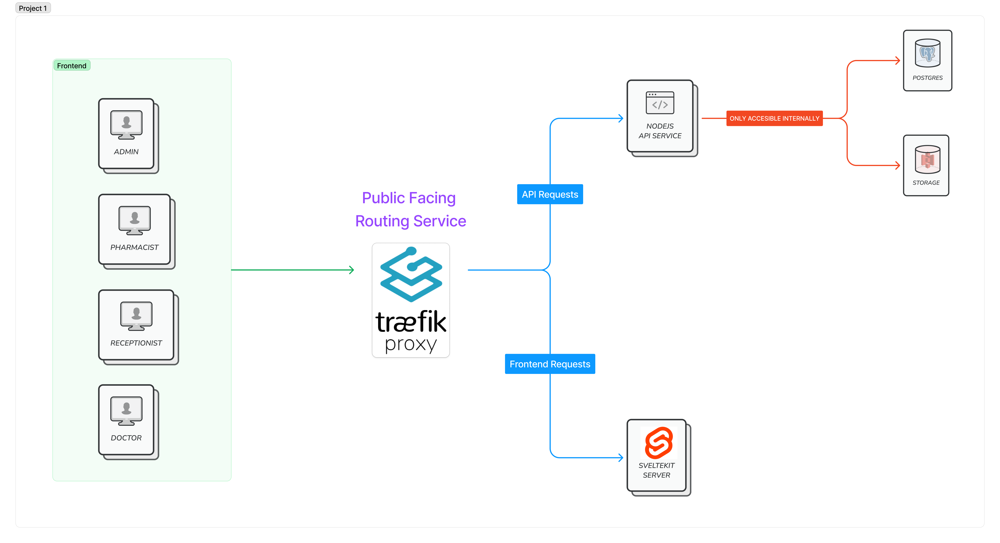

Below is the basic architecture and definition for the different modules.

We will be using Traefik as the proxy server for all incoming requests, and forwarding specific requests to respective modules.
 
Few things to keep in mind:
- Databases should never be exposed to the outside world.
- All incoming requests should be going through Traefik, services shouldn't be accessible publicly.
- Implement logging
- No RAW SQL in codebase
- Maintain code hygiene, readability
- Follow [DRY](https://www.baeldung.com/cs/dry-software-design-principle) principle strictly

## Status

| Module | Status |
|---|---|
| API: login/register with JWT | Working |
| Admin portal (static HTML) | Working |
| Doctor portal | Working |
| Receptionist portal | Working |
| Appointments, billing, prescriptions, patient history | In progress |
| Pharmacist and patient frontends | Not started |

### Modules
---------------------

**API Service**

Scope: `Backend`

Tech Stack: `Nodejs, Prisma ORM, Fastify Server, Postgres DB`

Authentication Method: `JWT`

Components:
- **Hospital**
	- *Public Endpoints*
		- Authentication
			- Login
			- Register
	- *Private Endpoints*
	    - Staff Management 
	    	- Doctors `CRUD`
	    	- Receptionist `CRUD`
	    	- Pharmacist `CRUD`
	    	- Patients `CRUD`
- **Receptionist**
 	- *Public Endpoints*
		- Authentication
			- Login
			- Register
	- *Private Endpoints*
	    - Appointments `CRUD`
	    - Patients `CRUD`
	    - Billing `CRUD`
	    - Invoices `CRUD`
- **Doctor**
 	- *Public Endpoints*
		- Authentication
			- Login
	- *Private Endpoints*
	    - Appointments `CRUD`
	    - Patients `CRUD`
	    - Prescriptions `CRUD`
	    - Patient History `CRUD`
- **Pharmacist**
 	- *Public Endpoints*
		- Authentication
			- Login
	- *Private Endpoints*
	    - Patients `CRUD`
	    - Prescriptions `CRUD`
	    - Billing `CRUD`
	    - Invoices `CRUD`
- **Patients**
	- *Public Endpoints*
		- Authentication
			- Login
			- Register
	- *Private Endpoints*
	    - Appointments `CRUD`
	    - Prescriptions `READONLY`
	    - Invoices `READONLY`

---------------------

**Hospital (Admin)**

Scope: `Frontend (Desktop)`

Tech Stack: `Nodejs, SvelteKit, TailwindCSS`

Integration: `API Service`

Screens:
- *Public Pages*
	- Authentication
		- Login
		- Register
- *Private Pages*
    - Staff Management 
    	- Doctors `CRUD`
    	- Receptionist `CRUD`
    	- Pharmacist `CRUD`
    	- Patients `CRUD`

---------------------

**Receptionist**

Scope: `Frontend (Desktop)`

Tech Stack: `Nodejs, SvelteKit, TailwindCSS`

Integration: `API Service`

Screens:
- *Public Pages*
	- Authentication
		- Login
- *Private Pages*
	- Appointments `CRUD`
    - Patients `CRUD`
    - Billing `CRUD`
    - Invoices `CRUD`

---------------------

**Doctor**

Scope: `Frontend (Desktop)`

Tech Stack: `Nodejs, SvelteKit, TailwindCSS`

Integration: `API Service`

Screens:
- *Public Pages*
	- Authentication
		- Login
- *Private Pages*
	- Appointments `CRUD`
    - Patients `CRUD`
    - Prescriptions `CRUD`
    - Patient History `CRUD`

---------------------

**Pharmacist**

Scope: `Frontend (Desktop)`

Tech Stack: `Nodejs, SvelteKit, TailwindCSS`

Integration: `API Service`

Screens:
- *Public Pages*
	- Authentication
		- Login
- *Private Pages*
	- Patients `CRUD`
    - Prescriptions `CRUD`
    - Billing `CRUD`
    - Invoices `CRUD`

---------------------

**Patients**

Scope: `Frontend (Desktop)`

Tech Stack: `Nodejs, SvelteKit, TailwindCSS`

Integration: `API Service`

Screens:
- *Public Pages*
	- Authentication
		- Login
- *Private Pages*
	 - Appointments `CRUD`
    - Prescriptions `READONLY`
    - Invoices `READONLY`
